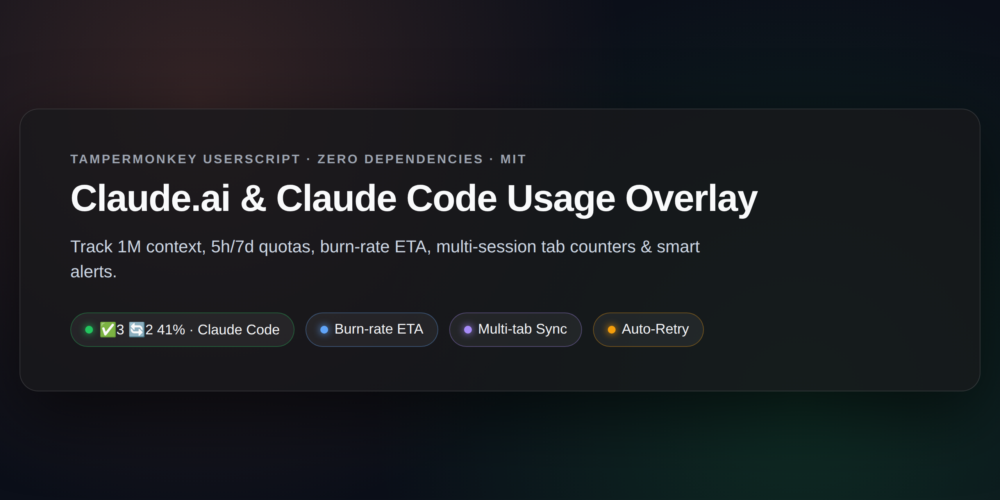
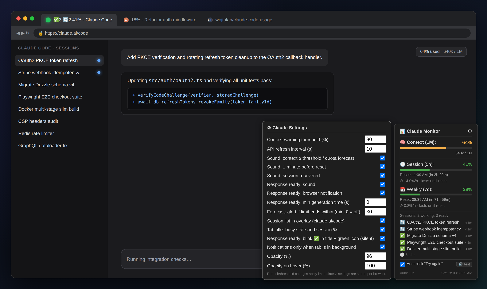
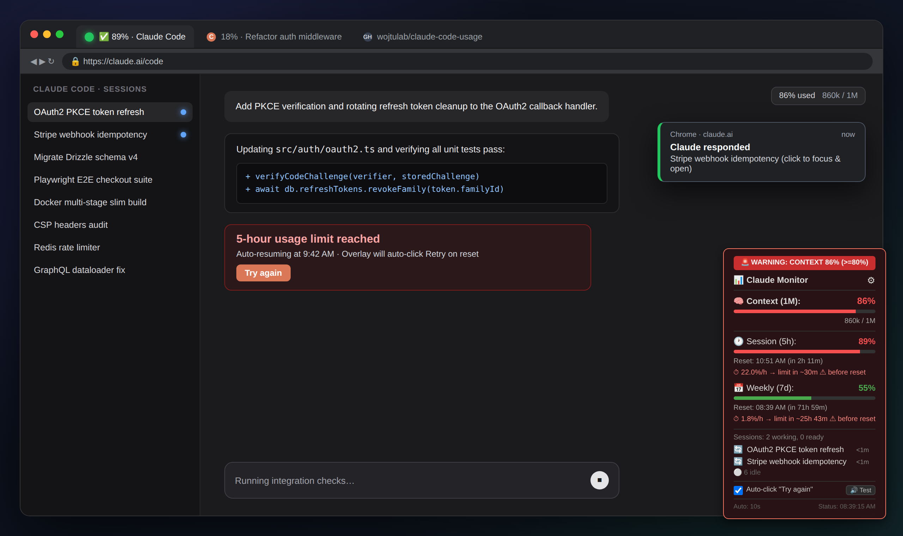

  

<h1 align="center">Claude.ai &amp; Claude Code Usage Overlay</h1>

  
  
  
  

A lightweight, zero-dependency Tampermonkey / Violentmonkey userscript for **claude.ai** and **claude.ai/code**. Track your **1M context**, **5-hour & 7-day usage limits**, **burn-rate exhaustion ETA**, **running/finished sessions**, and get **visual + sound alerts** when Claude finishes or recovers from rate limits — built for people running multiple parallel sessions (even with sound muted or on a second monitor).

---

## Screenshots

### Overlay, Live Session List & Settings (`⚙`)

### Context Warning, Quota Forecast, Clickable Notifications & Auto-Retry

---

## Key Features

- **1M Context Meter & Critical Pulse**
  - Scrapes your live context indicator (`64% used · 640k / 1M`) via a lightweight `TreeWalker` and flashes a red warning banner + pulsing border when reaching your threshold (default `80%`).
- **5h Session & 7d Weekly Quotas + Burn-Rate Forecast**
  - Reads live usage from `/api/organizations/<org>/usage` with automatic **429/401 exponential backoff** (up to 10 min; manual click bypasses backoff).
  - Records quota snapshots in `localStorage` and calculates your burn rate (`%/h`) over a rolling window (45 min for 5h, 6h for 7d). Warns you (`⏱ ... ⚠ before reset`) when you are on track to hit the limit before it resets.
- **Tab Title Counters, Blinking `❓` / `✅` & Colored Favicons**
  - Prefixes the browser tab title with live counters and 5h usage: e.g. `✅3 🔄2 41% · Claude Code`.
  - **Question / approval alerts (`❓`):** When a session or active chat waits for permission/approval/input (`QUESTION_SEL`), the overlay pulses orange, the tab blinks `❓` with an **orange favicon dot** (`#f97316`, taking priority over `✅`), and a single tab plays a chime + sticky notification (`claimOnce`).
  - When a background session completes, the tab blinks `✅` and switches the favicon to a bright **green dot** (`#22c55e`, static SVG data URI — works even when Chrome throttles background timers, and also triggers when the browser window is unfocused on a second monitor).
  - Automatically clears and restores your favicon as soon as you switch back, focus, click, or press a key.
- **Compact Mini-Mode (`–` / `+`) & Stable Controls**
  - Collapse the overlay to a single-line pill (`🤖 5h: 41% · 7d: 12%`) via `–`/`+` in the header (saved in `claude_overlay_cfg_v1`).
  - Pauses DOM rebuilds while holding down a click on checkboxes/buttons (`overlayPointerDown`) and skips redundant re-renders so 1s countdown updates never swallow clicks.
  - Settings panel (`⚙`) adapts to screen edges and closes on `Escape` or clicking outside.
- **Live Session List (`claude.ai/code`) & Click-to-Jump**
  - Lists all running (`🔄`) and recently finished unvisited (`✅`) coding sessions with elapsed duration and idle count (`⚪`).
  - Click any row in the overlay — or click the browser notification — to focus the tab and jump directly to that session.
- **Multi-Tab Coordination**
  - Open as many `claude.ai` tabs as you want: tabs elect one winner per event via `localStorage` claims (`claimOnce`) so you get **one sound and one notification** instead of a chorus.
  - `/usage` snapshots (`claude_overlay_state_v1`), forecast history, and alert flags stay synchronized across tabs via `storage` events (avoiding redundant API polls when another tab fetched recently).
- **Smart Audio & Sticky Notifications**
  - Single shared Web Audio API context unlocked on your first click/keypress (bypassing autoplay blocks when alerts fire from background tabs); stale signals delayed by >1.5s are dropped rather than playing late when you return.
  - Completion notifications use `requireInteraction: true` so they don't vanish before you see them, and automatically close when you return to the tab.
- **Reset Chimes & Auto-Click "Try again"**
  - Plays a gentle chime 1 minute before session reset, an ascending chord on recovery, and automatically clicks **"Try again"** (up to 3 attempts) once the reset timer passes.

---

## Installation

1. Install [Tampermonkey](https://www.tampermonkey.net/) (or [Violentmonkey](https://violentmonkey.github.io/)) in Chrome, Edge, Brave, or Firefox.
2. Click the install button below (or open the raw file):
   👉 **[Install `claude-usage.user.js`](https://raw.githubusercontent.com/wojtulab/claude-code-usage/main/claude-usage.user.js)**
3. Click **Install** when Tampermonkey prompts you, then reload `claude.ai`.

*(Manual alternative: open `claude-usage.user.js`, copy its contents, create a new Tampermonkey script, paste, and save.)*

---

## Settings (`⚙`)

Click the **⚙** icon in the top-right corner of the overlay to customize everything on the fly (saved per browser in `localStorage` under `claude_overlay_cfg_v1`):

| Setting | Default | Description |
| --- | :---: | --- |
| Context warning threshold (%) | `80` | Highlights context bar in red and triggers critical pulse |
| API refresh interval (s) | `10` | Foreground polling interval (background tabs poll at most every 60s) |
| Sound: context ≥ threshold / quota forecast | `true` | Chime on high context or burn-rate forecast warning |
| Sound: 1 minute before reset | `true` | Gentle chime 60s before the 5h session resets |
| Sound: session recovered | `true` | Ascending chord when the 5h window resets |
| Question / approval: sound | `true` | Two-tone chime when a session or chat waits for permission/input |
| Question / approval: browser notification | `true` | Sticky notification with session title (click to open session) |
| Response ready: sound | `true` | Two-tone chime when generation completes |
| Response ready: browser notification | `true` | Sticky notification with session title (click to open session) |
| Response ready: min generation time (s) | `10` | Ignores very short replies below this duration |
| Forecast: alert if limit ends within (min, 0 = off) | `30` | Fires once per reset window if quota runs out before reset |
| Session list in overlay (claude.ai/code) | `true` | Shows running / finished / idle session list in the overlay |
| Tab title: busy state and session % | `true` | Prefixes tab title with `✅N 🔄N 41% · ...` |
| Response ready: blink `✅` in title + green icon (silent) | `true` | Blinks `✅` and switches favicon to green while away |
| Notifications only when tab is in background | `true` | Suppresses desktop notifications when actively focused (background sessions in list still notify) |
| Opacity (%) | `50` | Idle overlay opacity |
| Opacity on hover (%) | `90` | Overlay opacity while hovered |

- **Drag to move:** Drag the overlay anywhere; position is saved per browser (`claude_overlay_pos_v1`).
- **Manual refresh:** Click the overlay background to refresh immediately (also requests browser notification permission if not granted yet).

---

## Privacy & Permissions

- Runs with `@grant none` — no special Tampermonkey API permissions, no sandbox escapes, and **no external servers or analytics**.
- Communicates solely with `claude.ai/api/organizations/...` using your existing browser session (`same-origin`).
- All configuration, forecast history, and diagnostics remain strictly inside your browser's `localStorage`.

---

## Troubleshooting & Diagnostics

Open DevTools (`F12` → Console) on `claude.ai`:
- `__claudeDiag()` — prints a table of the last 120 detection/audio/notification/backoff events (`spin+`, `spin-`, `stop+`, `stop-`, `alert`, `claim-lost`, `backoff`, `audio:running`, etc.).
- `__claudeDumpRows()` — inspects detected sidebar `[data-row-key]` rows and their `question` flag, active CSS animations, and `data-cds` states.
- **No desktop notifications?** Look for the orange prompt banner at the top of the overlay and click it, or allow notifications via the lock icon next to the URL bar.
- **No sound from background tabs?** Click anywhere on the `claude.ai` page once after loading so the browser unlocks Web Audio autoplay for that tab.

---

## Companion Script

Using **Google Antigravity** as well? Check out **[antigravity-usage](https://github.com/wojtulab/antigravity-usage)** — the companion overlay for Gemini, Claude/GPT, and Argon quotas with question & completion alerts.

## License

[MIT](LICENSE)
